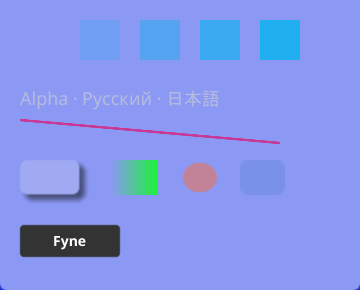

# WindowVisuals и WGL/DWM: протокол прототипа

Продолжение: переносимые Transparent/SystemBlur и Linux X11/Wayland описаны в
[LINUX_WINDOW_VISUALS_VALIDATION](LINUX_WINDOW_VISUALS_VALIDATION.md).

13 октября 2026. Реализован opt-in оконный API в настоящем Fyne: Mica,
Mica Alt, Desktop Acrylic и Opaque. На Windows 11 build 26300 подтверждены
видимый материал, фактическая alpha-композиция и подготовка до первого Show.
Это протокол текущего стенда; обязательная приёмка на 22621/22631 ещё не закрыта.

## Реализация и контракт

`driver/desktop/visuals.go` содержит отдельный optional `WindowVisuals` и
`ConfigureWindowVisuals`. Базовые интерфейсы Fyne не расширены обязательными
методами. Configure безопасен с любой goroutine; принимает параметры и
монотонный requestID, синхронно резервирует требования до native creation.
Нативные операции и observers выполняются на UI goroutine. Новые запросы
вытесняют незавершённые старые; уведомления объединяются. Cancel отбрасывает
очередные уведомления, уже вошедший callback может завершиться.

Native backdrop до создания автоматически требует alpha. `PrepareAlpha: true`
позволяет заранее создать Opaque-окно для последующих переключений. Поздний
запрос несовместимого формата возвращает `ErrVisualNeedsRecreate`, HWND скрыто
не пересоздаётся. Параметры проверяются до принятия requestID. Закрытие даже
до native creation завершает последнее поколение фазой Closed, удаляет окно
из driver и исполняет OnClosed.

Capabilities разделяют support ОС, support рендерера и проверенную созданную
поверхность. Status разделяет Requested/Selected, Pending/Ready/Fallback/Failed/
Closed, SurfaceReady, NativeAccepted, HRESULT и причину. Ready подтверждает
собственную подготовку и принятые вызовы API; это не датчик внутреннего решения DWM.

WGL получает `TransparentFramebuffer` только перед своим CreateWindow; hint
сбрасывается и при ошибке. Проверяется actual GLFW transparency, Win32 pixel
format alpha и GL_ALPHA_BITS. Включён документированный SYSTEMBACKDROP_TYPE:
main → Mica, tabbed → Mica Alt, transient → Desktop Acrylic. Caption согласуется
с темой, системная рамка сохраняется. Для build 26100+ дополнительно применяется
REDIRECTIONBITMAP_ALPHA. На более ранних ОС эта ветка не запрашивается.
Границы атрибутов определены [Microsoft DWM attributes](https://learn.microsoft.com/en-us/windows/win32/api/dwmapi/ne-dwmapi-dwmwindowattribute),
назначения — [DWM backdrop types](https://learn.microsoft.com/en-us/windows/win32/api/dwmapi/ne-dwmapi-dwm_systembackdrop_type).

Отдельное состояние painter выбирает Legacy, Opaque или Backdrop. Backdrop
очищается RGB=0/A=0, Opaque — прямым цветом background/A=1. Глобальная тема не
изменяется. Straight-color passes используют отдельное смешивание alpha
`ONE, ONE_MINUS_SRC_ALPHA`; premultiplied image passes сохраняют свои факторы.
Это исправляет A² в тексте, геометрии и тенях. Compact GL-профиль содержит
51 функцию вместо 50, включая BlendFuncSeparate; strict GLES 2.0 поддерживает
тот же контракт. Capture сохраняет actual alpha для новых режимов, прежняя
семантика Legacy Capture сохранена. Пользовательский shader обязан выдавать
premultiplied RGBA при оконном backdrop.

При изменении clear mode инвалидируется snapshot cache материалов. Над
прозрачной поверхностью материал со снимком нижних слоёв заменяет покрытую
часть, а не делает повторный alpha-over того же содержимого. Иначе A=64
превращался в A=112. Исправление использует GPU coverage pass и additive pass;
mask совпадает с rounded mask и bilinear upsampling renderer. Нет CPU readback,
новой snapshot texture или дополнительного FBO. Программа создаётся лениво
только для материала на Backdrop и удаляется с owning context. Legacy/Opaque
путь не добавляет этот проход.

Оба swap buffer полностью отрисовываются скрытыми перед Show и повторным
показом. При переходе к Opaque сначала публикуются непрозрачные кадры, затем
выключаются backdrop/redirection alpha. Отказ GL loader не вызывает draw с nil
context: статус Failed, SurfaceReady=false, неподготовленное окно остаётся
скрытым. PreparedFrames отражает отправленные кадры; старые счётчики не
подменяют успешность текущей подготовки.

Windows policy учитывает документированный high contrast, разрешение
прозрачности пользователя, optional SystemAppearance и явный HighContrast
темы. Дополнительно контролируются composition и remote session. Ограничения
ОС не отменяются разрешением приложения. По умолчанию выбирается Opaque;
strict policy сообщает Failed и также готовит безопасную непрозрачную
поверхность, когда рендерер работоспособен. На X11/Wayland/macOS нет имитации
Windows backdrop — возвращается Opaque/UnsupportedOS. WebGL выбирает
Opaque/UnsupportedBackend. Software/test drivers без optional интерфейса
получают `ErrVisualUnsupported` от helper.

В обычном окне проверка policy — одно atomic read, без системных запросов и
mutex. Для opt-in окна policy проверяется не чаще двух раз в секунду; неизменное
состояние не вызывает дополнительную отрисовку. Два подготовительных кадра
нужны только при применении/показе, постоянного цикла ради backdrop нет.

## Реальный Windows-стенд и результаты

Windows 11 Pro 10.0.26300; Intel i5-13400; около 64 GiB RAM; RTX 4080 SUPER;
драйвер 32.0.16.1692; текущий дисплей 2560×1440, 360 Hz; Go 1.27.1 amd64.
Сцена — client 360×290, пять RGBA patches и обычные текст, glyph atlas,
линия, SVG, raster, shadow, GPU material и button. WGL alpha: actual 8 bits.
Исходная Fyne-база: `7f99a87b0e1903ebc17f3c8c8f478b840a6eabe5` с локальными
доработками этого workspace.

Тест читает GL framebuffer отдельно от DWM. Для оптической части используются
два собственных Fyne HWND. Перед снимком проверяются foreground, отсутствие
перекрытия client и непосредственно лежащий под ним собственный фон. Фикстура
временно держит оба своих окна сверху; снимок ограничен их client area.
Для Acrylic сменяются красный/синий фон и шахматный raster. Один принятый
HRESULT не проходит оптические gates.

| Проверка | Результат на стенде |
| --- | --- |
| Mica, фон red/blue | RGB прозрачного участка 240/243/249 в обоих случаях |
| Mica Alt, фон red/blue | 213/219/228 в обоих случаях; отличается от Mica |
| Desktop Acrylic, red | 242/138/132 |
| Desktop Acrylic, blue | 139/153/244; средняя абсолютная разница 76.67/255 |
| Blur шахматного фона | Stddev канала: Acrylic 0.449, raw alpha 119.000 |
| Screen alpha patches 0/25/50/75/100% | Максимальная ошибка 1/255 для Mica/Alt, 0.75/255 для Acrylic |
| GL RGBA всего stock scene | RGB ≤ A с допуском 1/255; при A=0 RGB строго 0 |
| Первый кадр | Оба буфера подготовлены скрытыми; hidden front readback валиден; первый DWM sample уже Mica, совпадает с установившимся фоном |
| Opaque и high contrast fallback | Actual framebuffer alpha=255 во всех пикселях |
| Формат/жизненный цикл | pre-create reservation, late NeedsRecreate, hint isolation, latest-wins, UI callbacks/cancel, close до Show, hide/show, resize, HWND generation |
| Native frame | HWND и структурные GWL_STYLE сохранены; caption остаётся |
| GL loader failure | Failed/SurfaceReady=false, нет draw/показа неподготовленного окна |
| Material cache и покрытие | Opaque↔Backdrop, прозрачные lower layers, rounded corners, downsample 1/2/4; RGBA error ≤2/255 |

Снимки и машинный отчёт лежат в [window-visuals-validation](window-visuals-validation/dwm-composition.json).
Пример реальной композиции Desktop Acrylic:



## Проверки и воспроизведение

Нативные Windows tests выполнены с `race`, `cgocheck2`, `checkptr=2` и
`migrated_fynedo`. Общий Windows root suite прошёл с race: 46 test packages.
Для Linux используется
f-test-bench: kernel 6.12.60, Go 1.27.1, Xvfb и headless Weston 10 scale=2.
Проверены GL/X11, strict GLES2/X11, GL/Wayland, GLES2/Wayland: фактический Opaque
fallback, alpha, поколения, отмена/закрытие, material coverage и отказ renderer.
Также прошли общий Linux root race suite (48 test packages), запуск галереи
и компиляция WASM. Software/test compatibility checks прошли с `no_glfw,ci`.
Headless Weston не является аппаратной приёмкой физического Wayland desktop.

PowerShell из корня workspace:

```powershell
$env:FYNE_TEST_WINDOW_VISUALS='1'
$env:FYNE_WINDOW_VISUALS_OUTPUT='X:\fyne\.build-visuals-probe\images'
$env:GOEXPERIMENT='cgocheck2'
go test -race -gcflags=all=-d=checkptr=2 -tags migrated_fynedo `
  -run '^(TestNativeWindowVisuals|TestWindowVisualsPolicy)' -count=1 -v ./internal/driver/glfw
```

Linux script: `scripts/validate-window-visuals-linux.sh`; запускается из
экспортированного workspace с аргументом родительского рабочего каталога, где
находится file proxy. Он использует собственные caches/runtime и удаляет свой
compositor runtime; итоговые логи сохраняются вызывающим процессом.

Галерея использует обычный Fyne API и показывает выбор материала/diagnostics:

```powershell
go run -tags migrated_fynedo ./cmd/fyne_gallery -backdrop mica
go run -tags migrated_fynedo ./cmd/fyne_gallery -backdrop mica-alt
go run -tags migrated_fynedo ./cmd/fyne_gallery -backdrop acrylic
```

Базовый сценарий приложения:

```go
w := a.NewWindow("Application")
_, err := desktop.ConfigureWindowVisuals(w, desktop.VisualOptions{
    Backdrop: desktop.BackdropMica,
    PrepareAlpha: true,
    Fallback: desktop.VisualFallbackOpaque,
    Frame: desktop.VisualFramePreserve,
})
// Обработать err, установить обычное дерево Fyne, затем Show.
```

`go vet` API, painter и gallery прошёл. Vet GLFW package дополнительно сообщает
семь прежних unsafe.Pointer diagnostics в clipboard_data_windows.go и
ime_reconversion_windows.go; файлы WindowVisuals предупреждений не добавили.
Эти diagnostics не означают проверенный дефект и не скрываются из протокола.

## Границы результата и следующий gate

WGL пригоден для прототипа на текущем NVIDIA/build26300 стенде. На этой
конфигурации D3D/DXGI/DirectComposition bridge не потребовался. Прямое
WGL→DWM представление сохраняется, CPU readback используется только явным
Capture/тестом. В production path нельзя добавлять ReadPixels на каждый кадр.

До приёмки Windows-профиля ещё нужны самостоятельные оптические протоколы
22621/22631 (ветка без attribute 39), Intel/AMD, physical mixed-DPI и 2K/4K,
RDP/VM, настройка прозрачности через ОС, light/dark/power transitions,
maximize/minimize/fullscreen/Snap/system menu и длительные performance runs
из ТЗ. Первый DWM sample и hidden front buffers не заменяют скоростную съёмку
первого scanout на всей матрице. macOS/mobile/browser runtime здесь не проверен;
Windows appearance provider реализован отдельным блоком:
[SYSTEM_APPEARANCE_VALIDATION.md](SYSTEM_APPEARANCE_VALIDATION.md).
Полный текст ТЗ не считается завершённым этим прототипом.
